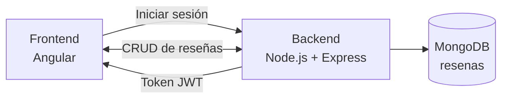

# Reseñas de Restaurantes — Final de Desarrollo Web

Aplicación web para la gestión de reseñas de restaurantes, desarrollada como entrega final de la asignatura **Desarrollo Web** (Ingeniería Informática, Unilasallista), a cargo del docente Néstor Vélez Vargas.

La solución permite que cada usuario se registre, inicie sesión y administre de forma privada sus propias reseñas de restaurantes (crear, consultar, editar y eliminar). Está compuesta por un frontend en Angular, una API REST en Node.js y una base de datos MongoDB, tal como se plantea en el diagrama del enunciado.

## Integrantes

- **Ricardo Jaraba Gallego**
- **Victor Manuel Cordoba Larez**

## Arquitectura



El flujo de la aplicación es el siguiente:

1. El usuario se autentica desde el frontend enviando sus credenciales al backend.
2. El backend valida las credenciales y responde con un **token JWT**.
3. El frontend almacena el token en el `sessionStorage` del navegador.
4. En cada petición posterior, el frontend envía el token en el encabezado `Authorization`. El backend lo valida, identifica al usuario y ejecuta la operación del CRUD únicamente sobre las reseñas de ese usuario.
5. La información se persiste en MongoDB.

## Estructura del repositorio

El repositorio contiene los dos proyectos que conforman la solución. No incluye carpetas propias del entorno de desarrollo (`node_modules`, `dist`, `.angular`, `.idea`, `.vscode`), conforme a lo indicado en el enunciado; para ello se incluyen archivos `.gitignore` en la raíz y en cada proyecto.

```
resenas/
├── backend/                     API REST en Node.js
│   ├── controllers/             Lógica de cada operación (usuarios, reseñas)
│   ├── helpers/                 Creación y validación del token JWT
│   ├── models/                  Esquemas de Mongoose (usuarios, reseñas)
│   ├── routes/                  Definición de las rutas de la API
│   ├── applications.js          Configuración de Express (middlewares y rutas)
│   ├── index.js                 Conexión a MongoDB y arranque del servidor
│   └── package.json
├── frontend/                    Aplicación Angular
│   ├── public/                  Recursos estáticos (favicon, tipografía)
│   ├── src/app/
│   │   ├── components/          Pantallas: login y home
│   │   ├── guards/              Protección de rutas
│   │   ├── interceptors/        Interceptor de autenticación
│   │   └── services/            Comunicación con la API y manejo de sesión
│   └── package.json
├── .gitignore
└── README.md
```

## Requisitos previos

- **Node.js 22 o superior** y **npm**.
- **MongoDB** en ejecución en el equipo local, escuchando en el puerto `27017`.

## Instalación y ejecución

Se deben ejecutar ambos proyectos, cada uno en su propia terminal.

**1. Backend**

```bash
cd backend
npm install
npm start
```

Al establecerse la conexión con la base de datos se muestra el mensaje `Conexion exitosa` y la API queda disponible en `http://localhost:2307`.

**2. Frontend**

```bash
cd frontend
npm install
npm start
```

La aplicación queda disponible en **http://localhost:2305**.

### Configuración

El backend puede configurarse mediante variables de entorno. Si no se definen, se utilizan los valores por defecto indicados.

| Variable | Descripción | Valor por defecto |
| --- | --- | --- |
| `MONGO_URL` | Cadena de conexión a MongoDB | `mongodb://localhost:27017/resenas` |
| `PORT` | Puerto del servidor de la API | `2307` |
| `JWT_SECRET` | Clave utilizada para firmar los tokens | Valor de desarrollo incluido en el código |

> El valor por defecto de `JWT_SECRET` está destinado únicamente al entorno de desarrollo. En un despliegue real debe definirse mediante la variable de entorno.

## Uso de la aplicación

1. **Registro:** en la pantalla inicial, la opción *Regístrate aquí* permite crear una cuenta con nombre, correo o usuario y contraseña. Una vez creada, la sesión se inicia automáticamente.
2. **Inicio de sesión:** el usuario ingresa sus credenciales. Si son correctas, el sistema obtiene el token, lo guarda en el `sessionStorage` y lo dirige a la pantalla principal.
3. **Crear una reseña:** en el panel lateral se diligencia el nombre del restaurante, la calificación, la fecha de visita y las observaciones, y se selecciona *Crear reseña*.
4. **Consultar reseñas:** la tabla *Mis reseñas* muestra únicamente las reseñas del usuario autenticado, ordenadas de la visita más reciente a la más antigua.
5. **Editar una reseña:** el botón de edición carga los datos en el panel lateral; tras modificarlos se confirma con *Guardar cambios*.
6. **Eliminar una reseña:** el botón de eliminación solicita confirmación antes de borrar el registro.
7. **Cerrar sesión:** elimina el token del `sessionStorage` y redirige al inicio de sesión.

## Cumplimiento del enunciado

| Requisito del enunciado | Implementación |
| --- | --- |
| Frontend desarrollado en Angular | Aplicación en Angular 22 con componentes standalone |
| El usuario inicia sesión y obtiene un token almacenado en el *session storage* | `Auth.guardarToken()` guarda el token JWT en `sessionStorage` tras el login |
| CRUD de reseñas por parte del usuario autenticado | Pantalla `home` con alta, listado, edición y eliminación |
| Backend que exponga mediante APIs el inicio de sesión y el CRUD | API REST con las rutas descritas en la sección *API REST* |
| Backend desarrollado en Node | Node.js con Express |
| Base de datos en MongoDB | MongoDB mediante Mongoose |
| Reseña con nombre del restaurante, calificación, fecha de visita y observaciones | Modelo `resenas` con los campos `nombreRestaurante`, `calificacion`, `fechaVisita` y `observaciones` |
| Cada usuario opera únicamente sobre **sus propias** reseñas | Todas las consultas se filtran por el usuario obtenido del token (ver *Aislamiento de datos por usuario*) |
| Entrega sin carpetas del entorno de desarrollo | Archivos `.gitignore` en la raíz y en cada proyecto |
| Ambos proyectos en un único repositorio público de GitHub | Carpetas `frontend/` y `backend/` en este repositorio |

## Modelo de datos

### Colección `usuarios`

| Campo | Tipo | Descripción |
| --- | --- | --- |
| `_id` | ObjectId | Identificador único generado por MongoDB |
| `username` | String | Correo o nombre de usuario. Obligatorio y único |
| `password` | String | Contraseña almacenada como hash `bcrypt` |
| `nombre` | String | Nombre con el que se muestra al usuario en la aplicación |

### Colección `resenas`

| Campo | Tipo | Descripción |
| --- | --- | --- |
| `_id` | ObjectId | Identificador único generado por MongoDB |
| `usuario` | ObjectId | Referencia al usuario propietario de la reseña. Obligatorio |
| `nombreRestaurante` | String | Nombre del restaurante. Obligatorio |
| `calificacion` | Number | Calificación entre 0 y 5, admite decimales. Obligatorio |
| `fechaVisita` | Date | Fecha de la visita, no puede ser posterior al día actual. Obligatorio |
| `observaciones` | String | Comentarios del usuario sobre la visita. Obligatorio |

## API REST

Rutas de usuario (públicas):

| Método | Ruta | Descripción |
| --- | --- | --- |
| POST | `/api/usuario/registrar` | Registra un nuevo usuario |
| POST | `/api/usuario/login` | Inicia sesión y devuelve el token |

Rutas de reseñas (requieren el encabezado `Authorization: Bearer <token>`):

| Método | Ruta | Descripción |
| --- | --- | --- |
| POST | `/api/resena` | Crea una reseña |
| GET | `/api/resenas` | Lista las reseñas del usuario autenticado |
| GET | `/api/resena/:_id` | Consulta una reseña propia |
| PUT | `/api/resena/:_id` | Actualiza una reseña propia |
| DELETE | `/api/resena/:_id` | Elimina una reseña propia |

### Ejemplos

**Registro** — `POST /api/usuario/registrar`

```json
{ "username": "correo@gmail.com", "password": "miClave123", "nombre": "María" }
```

Respuesta `201`:

```json
{
  "message": "usuario creado",
  "usuario": { "_id": "...", "username": "correo@gmail.com", "nombre": "María" }
}
```

**Inicio de sesión** — `POST /api/usuario/login`

```json
{ "username": "correo@gmail.com", "password": "miClave123" }
```

Respuesta `200`:

```json
{
  "token": "<JWT>",
  "usuario": { "_id": "...", "username": "correo@gmail.com", "nombre": "María" }
}
```

**Crear reseña** — `POST /api/resena`

```json
{
  "nombreRestaurante": "La Fogata",
  "calificacion": 4.7,
  "fechaVisita": "2026-11-20",
  "observaciones": "Excelente servicio y buena comida."
}
```

Respuesta `201`:

```json
{
  "message": "reseña creada",
  "resena": {
    "_id": "...",
    "usuario": "...",
    "nombreRestaurante": "La Fogata",
    "calificacion": 4.7,
    "fechaVisita": "2026-11-20T00:00:00.000Z",
    "observaciones": "Excelente servicio y buena comida."
  }
}
```

La actualización (`PUT`) acepta los mismos campos y permite enviar únicamente los que se desean modificar.

### Reglas de validación

| Campo | Regla |
| --- | --- |
| `nombreRestaurante` | Obligatorio, no puede estar vacío |
| `calificacion` | Numérica, entre 0 y 5 |
| `fechaVisita` | Fecha válida, no posterior al día actual |
| `observaciones` | Obligatorio, no puede estar vacío |

### Códigos de respuesta

| Código | Significado |
| --- | --- |
| `200` / `201` | Operación realizada correctamente / recurso creado |
| `400` | Datos incompletos o inválidos |
| `401` | Token ausente, inválido o vencido; o credenciales incorrectas en el login |
| `404` | La reseña no existe, no pertenece al usuario o el identificador no es válido |
| `500` | Error interno del servidor |

## Autenticación y seguridad

- **Contraseñas:** nunca se almacenan en texto plano; se guardan como hash `bcrypt`, y la API no las incluye en ninguna respuesta.
- **Token JWT:** firmado con la clave del servidor, contiene el identificador del usuario, su usuario y nombre, y tiene una **vigencia de 1 día**.
- **Almacenamiento de la sesión:** el token se guarda en el `sessionStorage`, por lo que la sesión se descarta al cerrar la pestaña o el navegador.
- **Protección de rutas en el frontend:** el guard de `/home` exige un token existente y no vencido; el guard de `/login` impide que un usuario ya autenticado regrese al formulario.
- **Interceptor HTTP:** agrega automáticamente el encabezado `Authorization` a las peticiones. Si la API responde `401`, cierra la sesión y redirige al inicio de sesión.

### Aislamiento de datos por usuario

Un usuario solo puede operar sobre sus propias reseñas, sin posibilidad de ver o modificar las de otros. Esto se garantiza en el backend, no en la interfaz:

- El propietario de una reseña **nunca se toma del cuerpo de la petición**: se obtiene del token validado (`req.userID`).
- El listado, la consulta, la actualización y la eliminación filtran siempre por `{ usuario: req.userID }`.
- Si un usuario intenta acceder a una reseña de otro mediante su identificador, la API responde `404`, igual que si no existiera, sin revelar que el recurso pertenece a alguien más.
- La actualización solo permite modificar los campos de contenido de la reseña, por lo que no es posible reasignar su propietario.

## Frontend

| Elemento | Archivo | Función |
| --- | --- | --- |
| Componente `Login` | `components/login/` | Formulario de inicio de sesión y de registro |
| Componente `Home` | `components/home/` | Resumen, tabla de reseñas y editor |
| Servicio `Auth` | `services/auth.ts` | Login, registro y manejo del token y de la sesión |
| Servicio `Resenas` | `services/resenas.ts` | Consumo de las APIs del CRUD |
| `authGuard` | `guards/auth-guard.ts` | Restringe `/home` a usuarios autenticados |
| `loginGuard` | `guards/login-guard.ts` | Redirige a `/home` si ya existe una sesión activa |
| `authInterceptor` | `interceptors/auth-interceptor.ts` | Adjunta el token y gestiona respuestas `401` |

## Dependencias

### Backend

| Paquete | Versión | Uso |
| --- | --- | --- |
| `express` | ^5.2.1 | Servidor web y definición de rutas |
| `mongoose` | ^9.9.3 | Modelado de datos y conexión con MongoDB |
| `bcrypt` | ^6.0.0 | Cifrado (hash) de contraseñas |
| `jwt-simple` | ^0.5.6 | Creación y validación de tokens JWT |
| `moment` | ^2.30.1 | Cálculo de las marcas de tiempo de emisión y expiración del token |
| `cors` | ^2.8.6 | Permite las peticiones del frontend desde otro origen |

### Frontend

| Paquete | Versión | Uso |
| --- | --- | --- |
| `@angular/core` | ^22.2.0 | Núcleo del framework |
| `@angular/common` | ^22.2.0 | Directivas, pipes y cliente HTTP |
| `@angular/compiler` | ^22.2.0 | Compilador de plantillas |
| `@angular/forms` | ^22.2.0 | Formularios reactivos |
| `@angular/platform-browser` | ^22.2.0 | Ejecución de la aplicación en el navegador |
| `@angular/router` | ^22.2.0 | Enrutamiento y guards |
| `rxjs` | ~7.8.0 | Manejo de flujos asíncronos en las peticiones HTTP |
| `bootstrap` | ^5.3.8 | Base de estilos y sistema de rejilla |
| `tslib` | ^2.3.0 | Funciones auxiliares de TypeScript |

Dependencias de desarrollo del frontend (incluidas por la plantilla de Angular CLI):

| Paquete | Versión | Uso |
| --- | --- | --- |
| `@angular/cli` | ^22.2.2 | Herramienta de línea de comandos de Angular |
| `@angular/build` | ^22.2.2 | Compilación y servidor de desarrollo |
| `@angular/compiler-cli` | ^22.2.0 | Compilador de Angular para TypeScript |
| `typescript` | ~6.0.2 | Lenguaje de programación |
| `prettier` | ^3.8.1 | Formateo del código |
| `vitest` | ^5.0.0 | Ejecutor de pruebas de la plantilla base |
| `jsdom` | ^30.0.0 | Entorno DOM de la plantilla base |

## Funcionalidades adicionales

Además de lo solicitado en el enunciado, se incorporaron las siguientes mejoras:

**Autenticación y seguridad**

- Registro de usuarios desde la propia interfaz, con inicio de sesión automático al crear la cuenta.
- Mensaje de error único (*Credenciales inválidas*) ante usuario inexistente o contraseña incorrecta, para no revelar qué usuarios existen.
- Control de expiración del token en el frontend: si la sesión vence, el usuario es redirigido al inicio de sesión.
- Interceptor HTTP centralizado que adjunta el token y cierra la sesión automáticamente ante una respuesta `401`.
- Guard adicional que evita que un usuario autenticado vuelva a la pantalla de inicio de sesión.
- Respuestas de error genéricas en el backend (el detalle técnico se registra únicamente en el servidor) y respuesta `404` ante identificadores inválidos.
- Configuración del backend mediante variables de entorno (`MONGO_URL`, `PORT`, `JWT_SECRET`).

**Gestión de reseñas**

- Calificación con decimales (por ejemplo `4.5` o `4.7`) mediante cinco estrellas SVG con relleno parcial y exacto, controlable de tres formas: arrastrando sobre las estrellas, con botones **+** y **−** de 0.1 en 0.1, o escribiendo el valor. El campo numérico acepta tanto punto como coma decimal.
- Fecha de visita con límite máximo dinámico igual al día actual, validada tanto en el formulario como en el backend.
- Validación de los datos en ambos extremos: en el formulario y en la API.
- Listado ordenado por fecha de visita, de la más reciente a la más antigua.
- Confirmación antes de eliminar una reseña.
- Edición en el mismo panel de creación, con opción de cancelar.
- Visualización de la fecha de visita sin desfases por zona horaria.

**Interfaz y experiencia de usuario**

- Panel de resumen con el total de reseñas guardadas, la calificación promedio y el número de reseñas eliminadas por el usuario (este último contador se conserva en el navegador).
- Avisos flotantes de éxito y error con barra de progreso y cierre manual.
- Saludo personalizado con el nombre del usuario en la cabecera.
- Diseño responsive, con ajustes para pantallas de escritorio, tabletas y teléfonos móviles.
- Identidad visual propia: paleta en tonos café, tipografía Nunito alojada localmente, iconos e ilustraciones en SVG y favicon incrustado.
- Animaciones suaves de entrada y transiciones, con respeto a la preferencia del sistema `prefers-reduced-motion`.
- Atributos de accesibilidad (`aria-label`, regiones `aria-live`) en controles y avisos.
